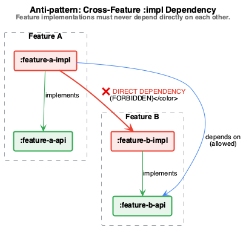

# Creating Decoupled Components

This skill describes how to create a decoupled software component. A component is split
into a public **API surface** and a hidden **implementation**, so that clients depend only
on a stable contract and never on internal details.

## Core idea

A component exposes an API surface to its users. This surface is a contract: it should not
change in a breaking way except for a major version bump. Everything else — the
implementation — is free to change at any time, because clients never see it.

This split is enforced at the module level. There are (at least) two Gradle modules:

- `$component-api` — the public contract. Clients depend on this.
- `$component-impl` — the implementation. Clients do **not** depend on this directly.

Naming is a team choice; flat (`:component-api`, `:component-impl`) and nested
(`:component:api`, `:component:impl`) layouts work equally well. With nested modules, two
leaf modules both called `api` produce identically named artifacts (`api.jar`, `api.klib`) —
give each module a unique archive / artifact name (e.g. `base.archivesName` or the
publication's `artifactId`), or the build may pick the wrong one.


> The diagram is generated from [`architecture.puml`](architecture.puml) with
> `plantuml -tpng architecture.puml`.

## When to split — and when not

The split costs two modules, an entry point and a little ceremony. It pays off when at
least one of these holds:

- **Several clients** use the component (features, apps, platforms).
- The implementation pulls in **heavy or volatile dependencies** (database, HTTP client,
  platform SDK) that clients should not compile against.
- Clients must be **testable without** the real implementation.
- The implementation is expected to be **swapped** (per platform, per environment, fake vs
  real).

For a pure helper with no I/O and a single caller, a plain `internal` class in the caller's
module is simpler. Splitting later is cheap as long as callers already go through an
interface.

## The API module (`$component-api`)

Contains only the contract: the interfaces clients call, plus any data types that are part
of the public surface. Nothing here exposes how the work is actually done.

```kotlin
// module: $component-api

data class SampleData(val userName: String, val age: Int)

interface ComponentApi {
    suspend fun loadData(): SampleData
    suspend fun saveData(data: SampleData)
}
```

Both `ComponentApi` and `SampleData` are part of the public API. Neither can change in a
breaking way without a major version bump (Semantic Versioning).

Rules for the API module:

- **Keep it light.** No database, network or platform libraries. Standard-library types,
  coroutines/`Flow` and serialization annotations are fine — they are part of the
  vocabulary, not of an implementation.
- **Only expose what clients need.** Every public declaration is a promise.
- **Turn on explicit API mode** so nothing becomes public by accident:

  ```kotlin
  kotlin { explicitApi() }
  ```

- **Guard the binary contract** when the module is published or consumed by separately
  compiled code: use ABI validation (the Kotlin Gradle plugin's built-in ABI validation or
  the `binary-compatibility-validator` plugin). It writes a reviewable `.api` dump and fails
  the build on unintended changes.
- **Be careful with `data class` in a published API.** Adding a property changes the
  constructor, `copy()` and `componentN()` — a binary-breaking change. For published
  libraries prefer a regular class with explicit `equals`/`hashCode`/`toString` (or a
  generator such as Poko). Inside a closed project a `data class` is fine.

> If the component lives inside a closed internal project and is never published (e.g.
> not pushed to Maven Central), strict versioning matters less, since there are no
> external consumers to break. The *discipline* of keeping the surface small and stable
> still pays off, because it keeps internal callers decoupled.

## The implementation module (`$component-impl`)

Depends on `$component-api` and implements the contract. Because clients never depend on
this module, its classes can and should be `internal` (or `private` where it fits), so
nothing leaks accidentally.

```kotlin
// module: $component-impl

internal class ComponentApiImpl(
    private val storage: Storage,
) : ComponentApi {
    override suspend fun loadData(): SampleData { /* ... */ }
    override suspend fun saveData(data: SampleData) { /* ... */ }
}
```

The implementation class itself is `internal`: a client could not reference
`ComponentApiImpl` even if it wanted to, because it is not visible outside its module. Its
own tests still can — a module's test source set sees its `internal` declarations.

## Build Configuration: Gradle & Maven Setup

To enforce this boundary at compile time, configure your build tool to hide implementation
details from the client modules.

### Gradle Setup (via the `java-library` plugin)

The `java-library` plugin introduces the distinction between `api` (transitive compile-time
dependencies) and `implementation` (internal dependencies, hidden from consumers). In a
Kotlin Multiplatform module the same two configurations exist per source set
(`commonMain.dependencies { api(...); implementation(...) }`).

The rule of thumb: **a dependency whose types appear in a public signature of your module is
`api`; everything else is `implementation`.**

1. **The API module (`$component-api`)**:
   Uses the `java-library` plugin so it can declare transitive dependencies via the `api`
   configuration.
   ```kotlin
   // $component-api/build.gradle.kts
   plugins {
       `java-library`
       kotlin("jvm")
   }

   dependencies {
       // Transitively exposes dependencies that are part of the public API signatures
       api("org.jetbrains.kotlinx:kotlinx-coroutines-core:1.8.0")

       // Internal dependencies of the api module (not leaked to clients)
       implementation("org.slf4j:slf4j-api:2.0.0")
   }
   ```

2. **The Implementation module (`$component-impl`)**:
   Exposes the API module via `api`, because its public entry point (factory, DI module)
   returns API types — whoever wires the impl needs them on the compile classpath. All
   third-party libraries (databases, HTTP clients) stay `implementation`.
   ```kotlin
   // $component-impl/build.gradle.kts
   plugins {
       `java-library`
       kotlin("jvm")
   }

   dependencies {
       // Implements the API contract; its types appear in the public entry point
       api(project(":$component-api"))

       // Hidden implementation details (e.g. database, network engine)
       implementation("io.ktor:ktor-client-cio:2.3.0")
       implementation("io.insert-koin:koin-core:3.5.0")
   }
   ```

   Never let an `internal` impl type or an `implementation`-only dependency type leak into
   a public signature. On the JVM this surfaces as a compile error at the consumer; on
   Kotlin/Native and Kotlin/Wasm it can compile and then fail at link time or at runtime.

3. **The Client module**:
   Only depends on the stable API. The compiler will prevent imports from Ktor, Koin, or the
   concrete implementation.
   ```kotlin
   // $client-module/build.gradle.kts
   dependencies {
       implementation(project(":$component-api"))
   }
   ```

4. **The App module (Composition Root)**:
   Depends on the implementation module; which configuration depends on how the instance is obtained:
   - It **calls the impl's public factory or DI module** (Options A–C below): the
     composition root needs the impl at compile time, so use `implementation`.
   - The impl is **discovered at runtime** without any compile-time reference (e.g. Java's
     `ServiceLoader` on the JVM): declare it `runtimeOnly`, so no code in the composition
     root can reference impl classes at all.
   ```kotlin
   // :app/build.gradle.kts
   dependencies {
       implementation(project(":$component-api"))
       implementation(project(":$component-impl")) // calls ComponentFactory.create(...)
       // runtimeOnly(project(":$component-impl"))  // only with runtime discovery (ServiceLoader)
   }
   ```

### Maven Setup (via dependency scopes)

In Maven, use dependency `<scope>` to control classpaths:

* **Implementation Module**: Depends on `:api` with default `compile` scope.
* **Client Module**: Depends on `:api` with `compile` scope.
* **App Module (Composition Root)**: Depends on `:impl` with `compile` scope when it calls the
  impl's factory; with `<scope>runtime</scope>` when the impl is discovered at runtime
  (`ServiceLoader`), which prevents any compile-time reference to implementation classes.

```xml
<!-- :app/pom.xml — runtime discovery variant -->
<dependencies>
    <dependency>
        <groupId>com.example</groupId>
        <artifactId>component-api</artifactId>
        <version>1.0.0</version>
    </dependency>
    <dependency>
        <groupId>com.example</groupId>
        <artifactId>component-impl</artifactId>
        <version>1.0.0</version>
        <scope>runtime</scope> <!-- Enforces runtime-only lookup -->
    </dependency>
</dependencies>
```

## Connecting the client to the implementation

The interesting question: an interface cannot do anything on its own, so the client needs an
actual instance — but it must obtain one **without depending on the impl module**. The
answer is to invert who creates it: the **composition root** creates the instance through a
public entry point of the impl module and **hands it to the client** (constructor parameter
or DI). The client only ever sees the interface type.


> The diagram is generated from [`sequence.puml`](sequence.puml) with
> `plantuml -tpng sequence.puml`.

### The public entry point is part of the contract

Whatever construction shape you pick is public and therefore subject to the same stability
rule as the rest of the API: it should not change in a breaking way between major versions.
Further interfaces returned or required by the entry point follow the **same pattern** —
they are declared in the API module, implemented `internal`ly, and obtained only through the
public surface.

### Option A — Factory in the impl module (default)

The impl module exposes exactly one public factory; everything else stays `internal`. The
factory returns the interface type, never the concrete class.

```kotlin
// module: $component-impl
object ComponentFactory {
    fun create(storage: Storage): ComponentApi = ComponentApiImpl(storage)
}
```

A top-level "pseudo-constructor" function is an equally idiomatic shape
(`fun ComponentApi(storage: Storage): ComponentApi = ComponentApiImpl(storage)`), in the
spirit of `MutableStateFlow(...)` or `Json { }`.

Only the composition root calls the factory; clients receive the result. Here only
`ComponentFactory` is visible from outside; `ComponentApiImpl` remains hidden.

### Option B — Configuration for the factory

When the component needs configuration — optional knobs or hard requirements — prefer
Kotlin's own tools before reaching for a builder: **named arguments with defaults** plus
validation.

```kotlin
// module: $component-api
class ComponentConfig(
    val timeout: Duration = 5.seconds,
    val maxRetries: Int = 3,
) {
    init {
        require(timeout.isPositive()) { "timeout must be positive" }
        require(maxRetries >= 0) { "maxRetries must be >= 0" }
    }
}

// module: $component-impl
object ComponentFactory {
    fun create(
        storage: Storage,                          // mandatory: no default
        config: ComponentConfig = ComponentConfig(),
    ): ComponentApi = ComponentApiImpl(storage, config)
}

// composition root
val component = ComponentFactory.create(
    storage = fileStorage,
    config = ComponentConfig(timeout = 10.seconds),
)
```

Mandatory collaborators are parameters without defaults — the compiler enforces them, no
runtime "was it set?" check is needed. Keep collaborators (interfaces such as `Storage`) out
of the config class: the config holds plain values, the factory takes the collaborators.

Use a **builder or a configuration DSL** (`ComponentConfig { timeout = 10.seconds }`) only
when named arguments stop scaling: many interdependent options, Java callers, or a
configuration that is assembled step by step. The builder lives in the API module and
produces the config — never the implementation.

### Option C — Dependency injection (optional refinement)

Dependency injection is **one possible way** to deliver the instance, not a requirement. The
impl module contributes a binding, the composition root loads it, and the client declares
the interface as a constructor parameter. Example with Koin — DSL:

```kotlin
// module: $component-impl
val componentModule = module {
    single<ComponentApi> { ComponentApiImpl(storage = get()) }
}
```

or Koin Annotations, where the impl binds itself via `@Single` / `@Factory`:

```kotlin
// module: $component-impl
@Single(binds = [ComponentApi::class])
internal class ComponentApiImpl(private val storage: Storage) : ComponentApi { /* ... */ }

@Module
@ComponentScan
class ComponentImplModule
```

```kotlin
// module: :app (composition root) — the only place allowed to depend on $component-impl
startKoin {
    modules(componentModule)                  // DSL
    // modules(ComponentImplModule().module)  // Annotations
}
```

This automates what Option A does by hand, at the cost of adopting the framework. It
reinforces — it does not replace — the rule that only the composition root wires the
`:impl` modules into the object graph.

## The composition root

The composition root is the module that wires the object graph — usually the
application/executable module. Every **runnable target has its own** composition root (an
Android app, an iOS app, a desktop app, a server, a CLI tool), and each may choose a
different impl for the same API (e.g. a platform-specific storage).

- It is the only kind of module allowed to depend on `:impl` modules.
- It creates instances (factory or DI) and hands them to clients.
- **Platform handles** (an Android `Context`, a window, a file-system root) are passed in
  from here as factory parameters. If a platform library forces a process-global
  initialisation, keep that inside the impl module and expose a single explicit
  `install(...)`-style function that only the composition root calls.

## Enforcing the module rules

A rule that is only a convention erodes. Make the build fail instead. A minimal check in a
convention plugin applied to every module:

```kotlin
// build-logic: convention plugin applied to all modules
val compositionRoots = setOf(":app")   // every runnable module

afterEvaluate {
    if (path in compositionRoots) return@afterEvaluate
    configurations.configureEach {
        dependencies.withType<ProjectDependency>().configureEach {
            val target = path   // ProjectDependency.path (Gradle 8.11+)
            check(!target.endsWith(":impl") && !target.endsWith("-impl")) {
                "${project.path} depends on $target — only composition roots may depend on impl modules"
            }
        }
    }
}
```

Dedicated module-graph assertion plugins offer the same with more options (allowed /
forbidden edges, rendered graphs). Whatever the tool, the forbidden edge must break CI.

## Unit Testing: Mocks vs. Fakes

Decoupling the API from the implementation lets client modules be tested in isolation.
Instead of standing up real databases, networks, or a full dependency tree, the test uses a
**test double** (either a dynamic mock or a hand-written fake) that implements the public
interface. Because clients only depend on `$component-api`, they never need
`$component-impl` to run their unit tests.

### Option A — Mocking with Mokkery (Kotlin Multiplatform)

If the project is a Kotlin Multiplatform (KMP) project, Mokkery is a great
compiler-plugin-based mocking tool:

```kotlin
// module: $client-feature-test (KMP / Multiplatform)
import dev.mokkery.answering.returns
import dev.mokkery.everySuspend
import dev.mokkery.mock
import kotlinx.coroutines.test.runTest

@Test
fun viewModel_exposes_loaded_user_mokkery() = runTest {
    val mockApi = mock<ComponentApi> {
        everySuspend { loadData() } returns SampleData("John Doe", 30)
    }

    val viewModel = MyViewModel(mockApi)
    viewModel.loadUser()

    assertEquals("John Doe", viewModel.state.value.userName)
}
```

(`everySuspend` is used because `loadData()` is a `suspend` function.)

### Option B — Mocking with MockK (Kotlin JVM / Android)

For traditional JVM or Android projects, MockK is the standard library:

```kotlin
// module: $client-feature-test (JVM / Android)
import io.mockk.coEvery
import io.mockk.mockk
import kotlinx.coroutines.test.runTest

@Test
fun viewModel_exposes_loaded_user_mockk() = runTest {
    val mockApi = mockk<ComponentApi>()
    coEvery { mockApi.loadData() } returns SampleData("John Doe", 30)

    val viewModel = MyViewModel(mockApi)
    viewModel.loadUser()

    assertEquals("John Doe", viewModel.state.value.userName)
}
```

(`coEvery` is used for suspending functions; use `every` for regular functions.)

### Option C — Fake Implementations (Fakes)

Instead of using mocking libraries (which rely on reflection or compiler plugins, compile
slower, and can make tests fragile to refactoring), you can write a manual **Fake** (test
double) that implements the stable API interface.

Fakes can live in the client's test source set or be shared via an `:api-test` module:

```kotlin
// module: $client-feature-test or :component-api-test
class FakeComponentApi : ComponentApi {
    private var data: SampleData = SampleData("Default User", 25)
    var shouldFail: Boolean = false

    override suspend fun loadData(): SampleData {
        if (shouldFail) throw IllegalStateException("Simulated network failure")
        return data
    }

    override suspend fun saveData(data: SampleData) {
        this.data = data
    }

    // Helper method to set up test scenarios
    fun seedData(data: SampleData) {
        this.data = data
    }
}
```

The test is clean, readable, and executes extremely fast:

```kotlin
@Test
fun viewModel_exposes_loaded_user_fake() = runTest {
    val fakeApi = FakeComponentApi().apply {
        seedData(SampleData("John Doe", 30))
    }

    val viewModel = MyViewModel(fakeApi)
    viewModel.loadUser()

    assertEquals("John Doe", viewModel.state.value.userName)
}
```

### Good practices for test doubles

- **Ship one shared fake with the component** in a small test-support module that depends
  only on `$component-api`, so every client reuses it instead of writing its own. Gradle's
  `testFixtures` is JVM-only; in Kotlin Multiplatform use a regular module.
- **Write a contract test once and run it against every implementation** — the real impl
  and the fake — so the fake cannot drift from the real behaviour:

  ```kotlin
  abstract class ComponentApiContractTest {
      abstract fun createSubject(): ComponentApi

      @Test
      fun saved_data_is_loaded_back() = runTest {
          val api = createSubject()
          api.saveData(SampleData("Ada", 36))
          assertEquals("Ada", api.loadData().userName)
      }
  }

  class FakeComponentApiTest : ComponentApiContractTest() {
      override fun createSubject(): ComponentApi = FakeComponentApi()
  }
  ```

- **Test the impl inside the impl module.** Its own test source set sees `internal`
  declarations, so `internal` never forces you to widen visibility for tests.

Being able to swap implementations so easily in tests is one of the strongest reasons for
the api/impl split.

## What the client sees

Regardless of which entry point is chosen, the client's view is identical and minimal:

```kotlin
// client module — depends ONLY on $component-api
class MyViewModel(private val component: ComponentApi) {
    suspend fun loadUser() {
        val data = component.loadData()
        /* ... */
    }
}
```

The client knows the interface. It knows nothing about `ComponentApiImpl`, the factory or
the DI framework, and a change to the implementation module never forces the client to
recompile against a new type.

## Common Anti-patterns

Watch out for these common design mistakes that break the Dependency Inversion Principle:

### Anti-pattern 1: Leaking Concrete/Internal Types in the API
The `:api` module must not reference any concrete classes from `:impl`. Furthermore, it
should not expose internal-only concepts or external libraries that clients shouldn't know
about.

```kotlin
// ❌ BAD: The API interface exposes the concrete internal implementation class
interface ComponentApi {
    fun getImplementationDetail(): ComponentApiImpl // Compile error! API doesn't know about Impl.
}

// ❌ BAD: The API exposes a library-specific type that leaks the implementation detail
// (e.g. database-specific exceptions or Room/SQLDelight query types)
interface ComponentApi {
    fun getQueryResults(): io.requery.query.Result<SampleData> // Leaks the query engine
}
```

*Solution:* Always return stable interfaces, standard library types, or pure domain data
classes declared in the `:api` module.

### Anti-pattern 2: Cross-Feature `:impl` Dependencies
A feature module `:feature-a-impl` should never declare a dependency on `:feature-b-impl`.



> The diagram is generated from [`anti-pattern-cross-dependency.puml`](anti-pattern-cross-dependency.puml) with
> `plantuml -tpng anti-pattern-cross-dependency.puml`.

*Solution:* `:feature-a-impl` must only depend on `:feature-b-api`. The actual wiring
between feature implementations must happen exclusively at the composition root (e.g. `:app`
module) — and the build should enforce it (see *Enforcing the module rules*).

### Anti-pattern 3: Circular Gradle Dependencies
This happens when you try to create an instance of the implementation directly inside the
`:api` module. Because `:impl` depends on `:api`, `:api` cannot depend on `:impl` without
creating a circular dependency.

```kotlin
// ❌ BAD: Creating a circular dependency by referencing the concrete implementation in API
// module: $component-api
object ComponentApiFactory {
    fun create(): ComponentApi = ComponentApiImpl() // Compile error: unresolved reference
}
```

*Solution:* Move the factory into `:impl` and call it only from the composition root
(Option A), or let a DI framework do the wiring (Option C).

### Anti-pattern 4: A Registry or Service Locator in the API Module
Because the API module cannot reference the implementation, it is tempting to add a global
registry that the impl module fills at startup and that clients pull instances from.

```kotlin
// ❌ BAD: module: $component-api
object ComponentRegistry {
    lateinit var factory: () -> ComponentApi
}

// somewhere in a client
val component = ComponentRegistry.factory()
```

Dependencies become invisible, the order of initialisation matters, a forgotten
registration fails only at runtime, and tests have to reset global state.

*Solution:* Pass instances in — the composition root creates them and hands them to clients
via constructor parameters or DI.

## Summary of the rules

- The API surface is a contract; treat it as stable between major versions. Use explicit
  API mode, and ABI validation where binaries are consumed separately.
- Put the contract (interfaces + public data types) in `$component-api`; keep it free of
  database, network and platform libraries.
- Put the implementation in `$component-impl`, marked `internal`/`private`. It depends on
  `$component-api` via `api(...)`, on everything else via `implementation(...)`.
- Clients depend on `$component-api` only.
- **No feature module may depend directly on another feature's `:impl` module.** Only
  composition roots may depend on `$component-impl` modules, and the build enforces it.
- Each runnable target is its own composition root: it creates instances through the impl's
  public entry point (factory, factory + config, or DI) and passes them in. Platform
  handles come in as factory parameters.
- Prefer named arguments with defaults over builders; prefer passing instances over
  registries / service locators.
- Further interfaces follow the **same pattern**: declared in the API module, implemented
  `internal`ly, obtained through the public surface.
- Clients are tested against the contract (mock or shared fake); fakes and the real impl
  pass the same contract test.
